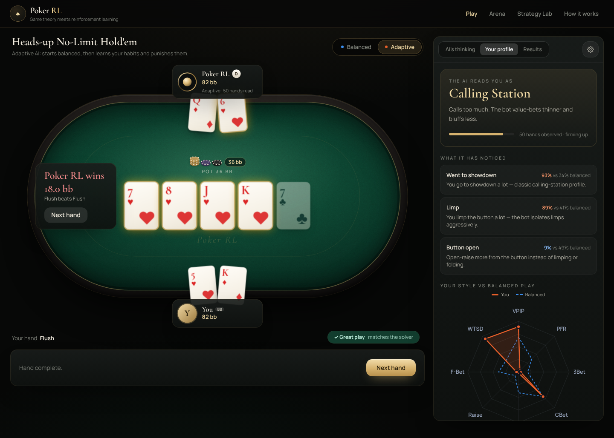
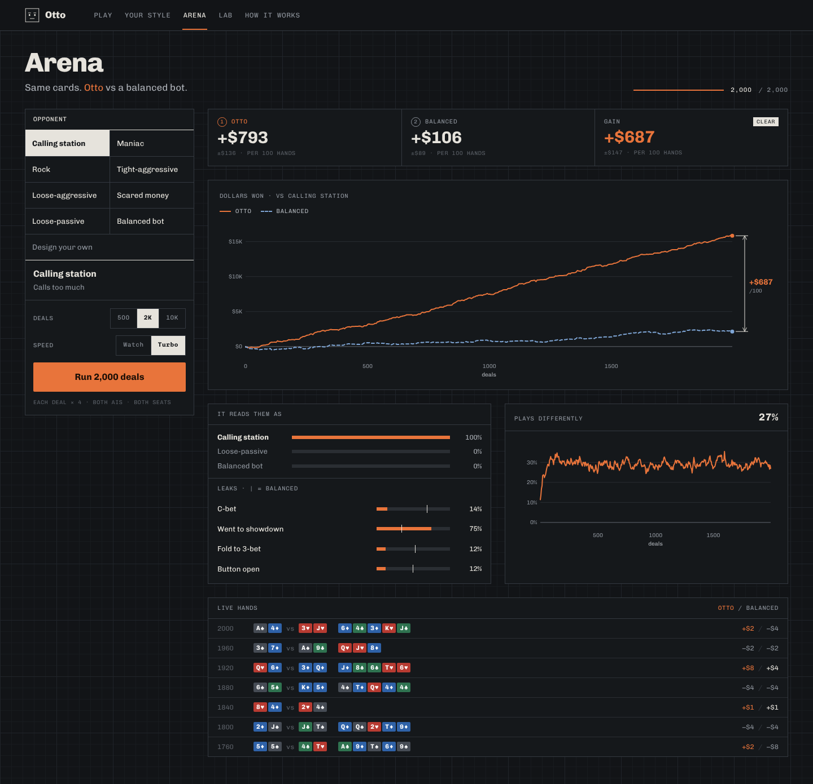
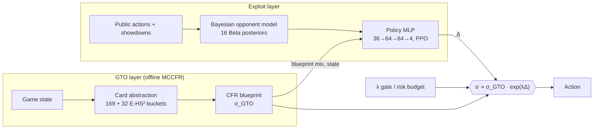

<div align="center">

# ♠ Poker RL

**A heads-up no-limit hold'em AI that plays game-theory-optimal poker — then learns to exploit *you*.**

A Monte Carlo CFR equilibrium blueprint, a Bayesian opponent model, and a PPO-trained policy network that tilts the blueprint toward the plays that punish an opponent's leaks — all running live in the browser with an explainable "X-Ray" of every decision.

`TypeScript` · `React 19` · `Vite` · `Tailwind v4` · `Framer Motion` · `Web Workers` · `Node worker_threads` · `Vitest`

</div>



---

## Highlights

| | |
|---|---|
| **GTO layer** | External-sampling **MCCFR** with linear-CFR discounting and regret-based pruning, trained in parallel on worker threads and merged by reach-weighted strategy sums. |
| **Abstraction** | 169 lossless preflop classes · 32 **E[HS²]** percentile buckets per postflop street · ⅓ / ½ / pot / all-in bets · imperfect-recall history keyed on SPR + initiative · **pseudo-harmonic** translation of off-tree human bets. |
| **Opponent model** | 16 **Beta-Bernoulli posteriors** (VPIP, 3-bet, c-bet, fold-to-c-bet, river folds, showdown bluff rate…) with priors centred on the blueprint's own frequencies, plus Bayesian archetype classification. |
| **Exploit layer** | A policy MLP outputs a bounded tilt Δ over four action groups; the final policy is `σ ∝ σ_GTO · exp(λΔ)`. Trained with **PPO**, an **asymmetric (privileged-information) critic**, **domain-randomised** opponent populations, and an L2 trust region to the blueprint. |
| **Safety** | λ = 0 is exactly GTO; with no evidence the opponent features are exactly zero; optional profit-based **risk budget** (safe exploitation). |
| **Explainability** | Gradient × input attribution turns every deviation into "*More big bets: 9% → 26% because you fold to bets 64% (GTO 41%)*". |
| **Evaluation** | **Duplicate** matches (seat-swapped replays of identical deals) with 95% CIs. |

## The demo

- **Play** — a fully animated table (3D card flips, chip physics, synthesized sound, keyboard shortcuts, phone layout). Slide the **GTO ↔ Exploit** dial to change how hard the bot attacks you.
  - **AI X-Ray** — blueprint vs exploit-adjusted probabilities for every bot decision, the network's tilt per action group, and the opponent tendencies that drove it.
  - **Read on You** — radar of your posteriors vs GTO with credible intervals, "You play like…" archetype match, and the specific leaks the bot is targeting with advice.
  - **Coach** — every decision you make is graded against the blueprint (Best / Good / Inaccuracy / Mistake / Blunder), with an accuracy score and an "Ask the solver" hint.
- **Arena** — Exploit AI and pure GTO play the *same* deals against any archetype (or a custom opponent you design with sliders) in a Web Worker; watch the curves separate and the bot's deviation from GTO grow as evidence accumulates.
- **Strategy Lab** — 13×13 preflop range explorer across seven scenarios, and postflop strategy-by-hand-strength charts that show the polarised bet/check structure CFR discovers on its own.
- **How it works** — architecture diagram, convergence and RL training curves, evaluation results and references.



## Results

<!-- RESULTS -->

## Architecture



### Repository layout

```
packages/engine     Dependency-free TS engine — runs in Node, workers and the browser
  src/game.ts         chip-accurate HUNL rules (min-raise, all-ins, refunds)
  src/evaluator.ts    bit-mask 7-card evaluator (~10M evals/s)
  src/equity.ts       Monte Carlo / exact equity, unbiased E[HS²]
  src/abstraction.ts  bet sizing, pseudo-harmonic translation, infoset keys, buckets
  src/cfr.ts          external-sampling MCCFR (+ linear CFR, pruning, merging)
  src/blueprint.ts    compact blueprint format + robust lookup
  src/opponentModel.ts Bayesian tendency tracking
  src/agents.ts       GTO / exploit agents, policy tilt, attributions
  src/nn.ts           tiny MLP with manual backprop + Adam
  src/archetypes.ts   parametric opponent styles + domain randomisation
  src/match.ts        duplicate evaluation
  src/coach.ts        decision grading, archetype classification
packages/training   Node training CLIs (worker_threads)
apps/web            React demo (Vite, Tailwind, Framer Motion, Web Worker arena)
```

## Quick start

```bash
npm install
npm run dev            # http://localhost:5173 — trained models are committed
npm test               # engine unit tests
npm run typecheck
```

### Re-train from scratch

```bash
npm run train:blueprint -- --minutes 70 --workers 3 --buckets 32   # → apps/web/public/models/blueprint.json
npm run train:exploit   -- --minutes 40 --workers 4                # → apps/web/public/models/exploit.json
```

`train:exploit` also measures equilibrium baseline frequencies (blueprint self-play), archetype signatures, and runs the duplicate evaluation shown above.

## Design notes

- **Why tilt the blueprint instead of learning a policy from scratch?** A from-scratch RL policy is exploitable and data-hungry. Re-weighting an equilibrium keeps every within-group mix (bet sizes, bluff-to-value ratios) intact, makes λ = 0 a hard guarantee of GTO play, and reduces the RL problem to four interpretable numbers per decision.
- **Why a privileged critic?** Hand outcomes have a standard deviation of tens of big blinds, mostly card luck. Letting the value baseline see both hands (training only) removes most of that variance from the advantages.
- **Why Bayesian features?** Shrinkage toward the equilibrium prior means the network sees "balanced" until the data says otherwise, so the bot doesn't over-react to a handful of hands — and the same posteriors drive the credible-interval UI.
- **Imperfect recall.** Postflop infosets remember the current street exactly but compress earlier streets to SPR class + who had the initiative. This trades a little theoretical purity for a game small enough to converge in about an hour on a laptop.

## References

Zinkevich et al. 2007 (CFR) · Lanctot et al. 2009 (MCCFR) · Brown & Sandholm 2019 (Discounted CFR; Pluribus) · Ganzfried & Sandholm 2013 (action translation), 2015 (safe exploitation) · Johanson et al. 2013 (E[HS²] abstraction) · Schulman et al. 2017 (PPO) · Pinto et al. 2017 (asymmetric actor-critic) · Jacob et al. 2022 (piKL).

## License

MIT
